# MediaForge 业务流程与排查

启动和服务配置见 [README](../README.md#快速开始)，改动和验收约定见 [开发指南](../CONTRIBUTING.md)。

## 功能索引

| 功能 | 操作入口与行为 | 代码与验收入口 |
| --- | --- | --- |
| 表格导入 | 「爆款商品库 → 导入商品」上传 CSV 或 Excel，匹配商品图片后导入，保存商品信息、图片和检索索引。 | [导入与检索 API](../mediaforge/gateway/routers/rag.py) · [导入测试](../tests/test_product_import.py) |
| 商品链接导入与多图浏览 | 在商品库粘贴拼多多、抖音商城或 17 网分享内容。预览可切换已读取的图片，导入时首图作为封面，其余图片保留在商品相册。读取失败时可重新读取，符合条件时可手动上传。 | [链接导入](../frontend/src/components/ProductLinkImport.tsx) · [商品相册](../frontend/src/components/ProductPhotoGallery.tsx) · [本机浏览器助手](../frontend/product-browser/) · [多图导入测试](../tests/test_product_import.py) |
| 商品可见性管理 | 在商品库隐藏本企业的公共参考条目，可在「已隐藏」恢复。企业私有商品提供删除操作。 | [商品 API](../mediaforge/gateway/routers/products.py) · [隐藏、恢复和删除测试](../tests/test_product_delete.py) |
| 图片创作与拼多多默认值 | 打开空白图片创作表单，默认选中拼多多，仍可按商品切换目标平台。任务配置复用时，可以带入原先选中的平台和参数。通过 `POST /api/v1/batch/submit` 提交异步任务。 | [创作表单](<../frontend/src/app/(app)/batch/page.tsx>) · [批量提交 API](../mediaforge/gateway/routers/batch.py)。复核空白表单和复用任务两条路径。 |
| 工作台与任务详情 | 在工作台查看需要处理的任务，从任务列表进入详情，核对 SKU、进度、素材及失败原因。 | [任务详情](<../frontend/src/app/(app)/tasks/page.tsx>) · [任务 API](../mediaforge/gateway/routers/tasks.py) · [任务测试](../tests/test_tasks_list.py) |
| 单图补生成 | 在任务详情的「失败原因」对单张或全部可补生成的失败图操作，可填写修改要求。复核结果回到原任务，已成功的图片仍能打开。 | [失败处理组件](../frontend/src/components/TaskFailureSummary.tsx) · [补生成测试](../tests/test_tasks_list.py) |
| 图片生成服务切换 | 在「设置 → 图片生成服务」为每套配置保存名称、API 地址、API Key 和模型。可尝试读取模型列表、手动填写模型 ID，在多套配置与系统配置间切换。复核刷新后的启用项与正确的模型路由。 | [图片服务设置](../frontend/src/components/ImageProviderSettings.tsx) · [图片服务 API](../mediaforge/gateway/routers/image_provider.py) · [图片服务测试](../tests/test_image_provider.py) |
| 智能助手 | 对话检索参考图，按确认卡片核对生成配置，确认后提交任务并跟踪进度。 | [助手 API](../mediaforge/gateway/routers/agent.py) · [助手工具](../mediaforge/orchestrator/agent_tools.py) · [任务确认测试](../tests/test_agent_production_controls.py) |

## 图片生成与失败处理

```mermaid
flowchart TD
    A["图片创作 · 商品原图与生成配置"] --> B["提交任务 · PostgreSQL 记录任务和 SKU"]
    B --> C["Celery 按 SKU 取任务"]
    C --> D["准备商品信息、参考图和生成提示"]
    D --> E["按输出类型生成并检查图片"]
    E --> F{"是否符合自动重试条件"}
    F -->|符合| G["调整生成策略 · 再试一次"]
    G --> E
    F -->|其他结果| H["汇总任务状态 · 展示素材和失败原因"]
    H -->|人工选择补生成| I["本任务重新排队 · 处理选中的失败图"]
    I --> C
```



1. [任务分发](../mediaforge/orchestrator/dispatcher.py)建立任务和 SKU 记录，将工作交给 [Celery 任务](../mediaforge/orchestrator/tasks.py)。页面通过任务 API 和 SSE 获取状态。
2. [生成编排](../mediaforge/orchestrator/batch_graph.py)和[生成节点](../mediaforge/orchestrator/nodes.py)按 SKU 执行。商品原图提供款式、颜色和结构依据，参考图用于提取视觉风格。按所选输出类型生成主图、详情组图、白底图等素材。
3. [图片 Worker](../mediaforge/workers/image/base.py)执行质检和导出检查，保存实际生成的图片及其结果。生成链路在满足条件的质检失败时自动再试一次。任务可显示已完成、部分失败或失败，有图的失败结果可用于复核。
4. 任务详情的「失败原因」支持补生成单张或全部可补生成的失败图，可填写修改要求。`POST /api/v1/tasks/{job_id}/repair-images` 将指定输出放回原任务，已成功的图保持可用。任务级「重试」调用 `/retry`，按可重试 SKU 创建关联的新任务。 [失败原因组件](../frontend/src/components/TaskFailureSummary.tsx) · [任务接口](../mediaforge/gateway/routers/tasks.py)

## 模型与规则来源

| 要查什么 | 入口 |
| --- | --- |
| 实际使用的图片服务和模型 | 「设置 → 图片生成服务」查看当前配置。Worker 执行时读取当前启用配置，提交的模型别名匹配时使用其地址、模型 ID 和密钥。系统配置见 [.env.example](../.env.example)，选择逻辑见 [nodes.py](../mediaforge/orchestrator/nodes.py)。 |
| 平台提示、输出比例和各类型验图说明 | [platform_rules.py](../mediaforge/workers/platform_rules.py) |
| 图片组内分工 | [detail_page.py](../mediaforge/workers/image/detail_page.py)定义场景图、卖点图、细节特写的生成指令。 |
| 商品一致性、输出意图、尺寸和边缘纯白等质检 | [图片 Worker 基类](../mediaforge/workers/image/base.py)。审图模型由系统 `QUALITY_MODEL` 配置，任务详情展开 SKU 可查看质检记录。 |
| 拼多多白底图导出规格 | [pinduoduo_white_background.py](../mediaforge/workers/image/pinduoduo_white_background.py)定义图像处理、输出尺寸和文件大小检查。实际商品上架以对应平台商家后台的要求为准。 |

## 失败排查顺序

先记录任务 ID、SKU、具体图片类型和当前结果。任务详情可以展开 SKU 查看本轮提示词、参考信息及质检记录。按出现异常的位置找证据。

| 现象 | 先查哪里 |
| --- | --- |
| 商品链接导入后只看到首图 | 对照导入预览和商品相册，检查本机助手识别出的图片列表、用户选择和导入后展示。 [链接导入组件](../frontend/src/components/ProductLinkImport.tsx) · [商品相册](../frontend/src/components/ProductPhotoGallery.tsx) |
| 提交失败或任务长时间排队 | 检查 API 响应、Celery Worker 日志、对应优先级队列，以及任务和 SKU 状态。 [任务分发](../mediaforge/orchestrator/dispatcher.py) · [状态存储](../mediaforge/db/job_store.py) |
| 模型调用报错或没有图片 | 先核对任务模型别名与启用的服务，结合 Worker 日志检查上游接口响应。 [模型客户端](../mediaforge/workers/openrouter_client.py) |
| 图片生成了，卖点图和细节特写未通过 | 先对照失败图和「输出意图实现度」。卖点图检查商品卖点是否在构图中突出，特写检查画面是否清楚展示局部结构或面料。复核对应输出的提示词和质检原因，再决定是否补生成。 |
| 白底图未通过 | 先看原因属于生成图片边缘检查 `deterministic_checks`，还是最终文件规格 `export_checks`。边缘近白像素不足时，先复核生成图边缘是否有灰底或阴影。 |
| 任务报告成功但图片无法打开 | 核对素材状态和文件路径，检查登录后的文件接口以及 MinIO 对象。 [文件接口](../mediaforge/gateway/main.py) · [对象存储](../mediaforge/storage.py) |

本地启动后可用以下命令检查服务并查看近期日志。API 就绪、队列响应和业务图片验收各有独立证据。

```bash
docker compose ps
docker compose logs --tail 100 api celery-worker frontend
docker compose exec -T celery-worker celery -A mediaforge.celery_app inspect ping --timeout=5
```

如果 Compose 显示 Worker `unhealthy`，先确认容器的健康检查探测对象。后端镜像的默认健康检查访问 HTTP `/health`，Worker 进程响应可用上面的 `inspect ping` 检查。具体任务仍需核对对应队列和日志。 [后端镜像](../Dockerfile) · [Compose 配置](../docker-compose.yml)

| 存储 | 用途 |
| --- | --- |
| PostgreSQL | 租户、商品、任务与素材状态、图片服务配置 |
| MinIO | 商品原图、参考图和生成素材 |
| Redis 与独立的 Redis Broker | 缓存、SSE 事件和 Celery 队列 |
| Milvus / Zilliz Cloud | 参考商品的向量检索索引 |
