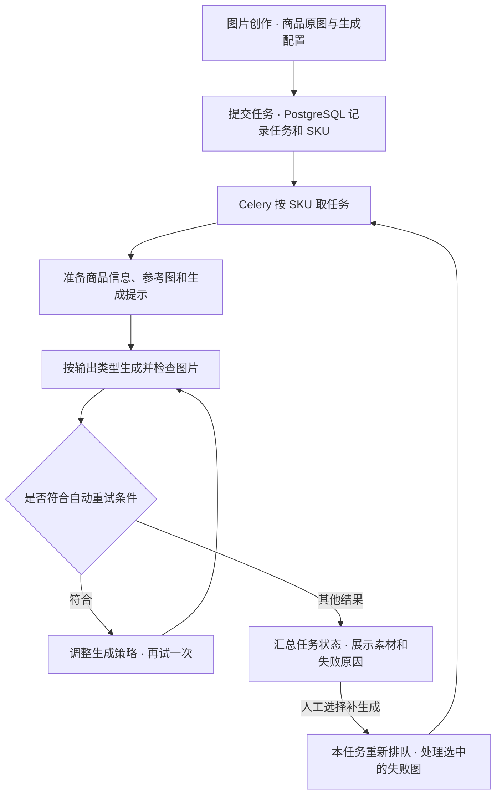

# MediaForge 业务流程与排查

启动和服务配置见 [README](../README.md#快速开始)，改动和验收约定见 [开发指南](../CONTRIBUTING.md)。

## 功能索引

| 功能 | 操作入口与行为 | 代码与验收入口 |
| --- | --- | --- |
| 表格导入 | 「爆款商品库 → 导入商品」上传 CSV 或 Excel，匹配商品图片后导入，保存商品信息、图片和检索索引。 | [导入与检索 API](../mediaforge/gateway/routers/rag.py) · [导入测试](../tests/test_product_import.py) |
| 商品链接导入与多图浏览 | 在商品库粘贴拼多多、抖音商城或 17 网分享内容。预览可切换已读取的图片，导入时首图作为封面，其余图片保留在商品相册。读取失败时可重新读取，符合条件时可手动上传。 | [链接导入](../frontend/src/components/ProductLinkImport.tsx) · [商品相册](../frontend/src/components/ProductPhotoGallery.tsx) · [本机浏览器助手](../frontend/product-browser/) · [多图导入测试](../tests/test_product_import.py) |
| 商品可见性管理 | 在商品库隐藏本企业的公共参考条目，可在「已隐藏」恢复。企业私有商品提供删除操作。 | [商品 API](../mediaforge/gateway/routers/products.py) · [隐藏、恢复和删除测试](../tests/test_product_delete.py) |
| 亚马逊调研 | 从工作台或侧栏打开「亚马逊调研」。单品沿用单页查询，类目和店铺通过任务采集。品牌店铺提交一个美国站链接即可识别首页并逐页采集，查看来源、状态、产品组合、价格带及归档，展开同配色尺码。可下载逐栏目快照，从「历史记录」恢复或重试失败项。 | [调研页面](<../frontend/src/app/(app)/research/page.tsx>) · [任务 API](../mediaforge/gateway/routers/amazon_research.py) · [店铺编排](../mediaforge/orchestrator/amazon_research.py) · [栏目采集](../mediaforge/rag/amazon_store_collection.py) · [采集与恢复测试](../tests/test_amazon_store_depth.py)。按[调研流程](#亚马逊调研)复核 REQ-001。 |
| 亚马逊调研工具（REQ-039–044） | 在「亚马逊调研 → 调研工具」运行关键词、Listing、PPC、FBA、到岸成本或 HS 查询。查看来源和缺项，下载 JSON 或从当前浏览器的「工具历史」恢复。 | [工具面板](../frontend/src/components/research/AmazonScriptTools.tsx) · [接口模型](../mediaforge/models/amazon_script_tools.py) · [验收步骤](#调研工具req-039044) · [固定样本测试](../tests/test_amazon_script_tools.py) |
| 类目深调研（REQ-012–020） | 「亚马逊调研 → 类目榜单」，自动发现子榜，可指定子榜与成本；在历史恢复报告并下载逐榜证据。 | [类目编排](../mediaforge/orchestrator/amazon_category.py) · [类目采集](../mediaforge/rag/amazon_category_collection.py) · [分析规则](../mediaforge/rag/amazon_category_analysis.py) · [固定样本](../tests/test_amazon_category_depth.py) |
| 亚马逊运营技能（REQ-045–095） | 「亚马逊调研 → 运营技能」，分组选择编号，填写事实、假设或授权报表汇总，生成和下载报告。 | [技能面板](../frontend/src/components/research/AmazonSkills.tsx) · [目录与分发](../mediaforge/workers/amazon_skills.py) · [基础技能](#亚马逊运营技能req-045060) · [进阶技能](#进阶运营技能req-061095) |
| 图片创作与拼多多默认值 | 打开空白图片创作表单，默认选中拼多多，仍可按商品切换目标平台。复用任务带入原有参数。亚马逊调研入口预选 Amazon、主图和详情图，并带入可编辑的风格要求。通过 `POST /api/v1/batch/submit` 提交异步任务。 | [创作表单](<../frontend/src/app/(app)/batch/page.tsx>) · [批量提交 API](../mediaforge/gateway/routers/batch.py)。复核空白表单、复用任务和调研带入路径。 |
| 工作台与任务详情 | 在工作台查看需要处理的任务，可隐藏单条提醒。通过「全部任务」进入详情，核对 SKU、进度、素材及失败原因。 | [工作台](<../frontend/src/app/(app)/dashboard/page.tsx>) · [任务详情](<../frontend/src/app/(app)/tasks/page.tsx>) · [任务 API](../mediaforge/gateway/routers/tasks.py) · [任务测试](../tests/test_tasks_list.py)。隐藏一条提醒并刷新，核对提醒数量及任务列表。 |
| 单图补生成 | 在任务详情的「失败原因」对单张或全部可补生成的失败图操作，可填写修改要求。复核结果回到原任务，已成功的图片仍能打开。 | [失败处理组件](../frontend/src/components/TaskFailureSummary.tsx) · [补生成测试](../tests/test_tasks_list.py) |
| 图片生成服务切换 | 在「设置 → 图片生成服务」为每套配置保存名称、API 地址、API Key 和模型。可尝试读取模型列表、手动填写模型 ID，在多套配置与系统配置间切换。复核刷新后的启用项与正确的模型路由。 | [图片服务设置](../frontend/src/components/ImageProviderSettings.tsx) · [图片服务 API](../mediaforge/gateway/routers/image_provider.py) · [图片服务测试](../tests/test_image_provider.py) |
| 智能助手 | 对话检索参考图，按确认卡片核对生成配置，确认后提交任务并跟踪进度。 | [助手 API](../mediaforge/gateway/routers/agent.py) · [助手工具](../mediaforge/orchestrator/agent_tools.py) · [任务确认测试](../tests/test_agent_production_controls.py) |

## 亚马逊调研

调研表单关闭浏览器自动填充历史。验收时聚焦链接或联想词输入框，检查浏览器历史下拉框不遮挡页面，并粘贴链接按回车提交。

1. **单品调研。** 填写 Amazon 美国站商品链接或 10 位 ASIN。报告展示公开页面可读的主图、商品价、评分、评分数、畅销排名和卖点。可补充每行一条的评论片段。报告分别标注商品公开页和手动录入来源，按评论片段提及次数整理主题，并据此给出产品复核及拍图建议。
2. **类目榜单。** 粘贴美国站 Best Sellers 链接，例如 `https://www.amazon.com/gp/bestsellers/fashion`。主榜保留前 30 个可识别商品，最多采集 5 个子榜，每榜最多 20 件。可指定子榜和利润假设。结果支持逐榜查看、下载和跳入单品调研；原单页 API 保持兼容。
3. **品牌店铺。** 粘贴带有 `/stores/` 和 `/page/` 的 Amazon 美国站店铺或栏目地址，只提交一次。也可从单品报告打开品牌店铺。采集从提交页查找品牌首页和导航，继续读取公开可发现的栏目和下拉子栏目。栏目按 UUID 去重，最多 30 个，商品卡片每栏最多 30 个 ASIN。查看「店铺栏目采集」里的原链接、最终链接、采集时间、方式、样本数量及原因。空页指公开导航或内容可以读取，页面没有可取样商品。动态占位、无法识别的结构或达到上限会显示样本不完整。Amazon 拒绝访问、拦截、超时或确定属于其他店铺时记录失败。
4. 各模式都可填搜索联想词种子并下载 Markdown。店铺还可在「店铺栏目采集」下载同一任务的 JSON，按栏目保留原样本、主图、公开报价及原币种、评分和评分数。Amazon 美国站请求设置 USD 和英语显示偏好，取样仍以页面返回的币种为准。样本汇总按 ASIN，商品可回查所在栏目。联想读取失败时，已有栏目结果仍可查看和下载。
5. 在单品报告编辑「图片制作需求」，再点「带入图片创作」。需求在当前浏览器标签页传入创作表单的风格要求。平台预选 Amazon 美国站，输出预选主图和详情图，使用已有[平台图规则](../mediaforge/workers/platform_rules.py)。填写自有商品原图、SKU、名称和类目后，按图片创作流程提交。
6. 点击「历史记录」。品牌店铺和类目深调研的进度与样本保存在当前企业及账号下，可跨设备恢复。参数相同的在途请求共享任务，完成后用户可主动重新采集。同一提交标识用于安全重复请求。旧单页快照仍可在原浏览器打开。

`POST /api/v1/research/amazon` 保留原单页协议与会话或 API Key 权限。新店铺任务通过 `POST /api/v1/research/amazon/runs` 返回 202 和任务 ID。页面轮询 `GET /amazon/runs/{id}`。Celery 的 `low` 队列读取 Amazon 公开 HTML，逐页写入 PostgreSQL。每项有请求时限，最多跟随 3 次已校验的跳转、并发 3 项，网络故障或超时最多读取两次。拒绝访问或限流保留状态与原因。举例，`POST /api/v1/research/amazon/runs/{id}/retry?target=failed&item_key=section-…` 可重试指定项，有效样本保留。队列派发失败或工作进程租约过期后，可从页面恢复原任务。日志记录任务 ID、序号、状态、类型和耗时，省略请求与响应正文。

店铺翻译复用已配置的文本模型（`OPENROUTER_API_KEY`、`OPENROUTER_BASE_URL`、`AGENT_MODEL`）。通用栏目使用词表，每次任务对其余字段最多翻译两批，每批 35 个。缺译时页面继续显示原名称、ASIN、主图和链接。旧同步接口的翻译与返回格式保持原有行为。

新版本启用店铺任务前，先执行 `uv run alembic upgrade head`，再更新 Gateway、监听 `low` 队列的 Celery worker 和前端。用 `/ready` 核对 PostgreSQL、Redis，提交一次品牌店铺，检查任务能从排队到完成或部分完成。需要回退时可切回原应用版本并保留新增的快照表，确认导出或另行备份之后再决定是否回退迁移。

**商品归档（REQ-002）。** 同一 ASIN 在汇总中只计一次，同时保留每个来源栏目。款式和配色归并只使用 Amazon 卡片规格表，每份表最多保留 100 个关系 ASIN 用于关联。卡片明确标记无变体时计为独立款。只有实际出现在栏目样本里的商品参与计数，证据不足或同一 ASIN 的规格值冲突时显示「待确认」。同配色尺码折叠还需尺码以外的规格保持一致，所有已采 ASIN 均可展开并链接到来源。页面、Markdown 和采集记录同时提供去重 ASIN、已确认款式与配色组的计数以及关系缺项数量。旧任务从原快照补算，原采集时间保持原值。归档规则见 [店铺样本归并](../mediaforge/rag/amazon_store_analysis.py)。

**样本快照（REQ-003）。** 在「店铺栏目采集」下载 `<任务 ID>-samples.json`。文件包含任务标识、采样开始与更新时间、美国站、各状态栏目的数量和实际商品记录数。新任务还记录采集当时的栏目与 ASIN 上限，以及导航超限情况。旧任务若缺少结构化上限，保留原样本与记录说明。每个栏目的 `evidence` 条目保留采集时间、请求和最终链接、样本范围及原始商品字段，包括 ASIN、主图链接、公开报价及币种、评分、评分数、规格关系。无法读取的字段为 `null`。商品归档中的「来源」链接展开并定位对应栏目的 ASIN，可打开公开商品或主图，点「返回归档」回到该尺码。复核时使用快照记载的实际范围。

REQ-003 复核时任选一组已采尺码，打开其 ASIN 来源，核对公开链接、图、报价口径和规格，再点击返回。下载 JSON 后比较两个来源以及采集时间。固定测试覆盖达到栏目上限、缺字段和旧快照读取。

从 Oakgarden 提交高领上衣栏目后，在「商品归档」展开一组尺码。抽查一个跨栏目 ASIN，核对它在汇总只有一个条目且带多个来源。下载报告，确认三个计数、待确认项及来源链接与页面一致。固定测试还覆盖规格表部分重叠、证据冲突与已存任务兼容。

单品接口示例传入 `{"mode":"product","source":"B0033SHO4Q","keyword":"toy story"}`。成功响应包含 `source_url`、`collected_at`、`product`、`suggestions` 和 `warnings`。链接类型不匹配时返回 `422`，上游页面无法读取时返回 `502`。

单页回归可用 `B0033SHO4Q` 和服装 Best Sellers 榜单，核对排名、主图和单品跳转。补充一条评论片段并查看来源与主题，然后编辑图片需求，检查带入「图片创作」表单。历史回归时，在原浏览器恢复改动前保存的报告，核对主图、联想词、采集时间和下载。

**产品组合与价格带（REQ-004）。** 在店铺结果打开「产品组合与价格带」。全店采样汇总以去重 ASIN 为单位，选择登记顺序中第一个有效 USD 单价。价带按 15、25、40、60 USD 分段，包含下界，排除上界。占比按具有有效 USD 单价的 ASIN 计算，单列没有价格以及非 USD、区间或无法确认为有效单价的商品。展开价格带可跳到用于计算的栏目商品。各栏目显示样本量、有效价位数、评分均值与公开评分数中位数，保留样本数。公开评分数可能跨同款共享，领先款每个确认同款组取一个最高公开评分数的 ASIN。

报告同时列出跨栏目重叠、平台类型、配色与尺码组合、标题尾部编号候选和公开新品栏目样本。编号需在商品页核实，无法识别新品或缺少公开字段时保留未知。页面、Markdown 及栏目 JSON 使用同一矩阵。旧报告继续保留既有字段。规则见 [店铺统计](../mediaforge/rag/amazon_store_analysis.py)。验收时从 Oakgarden 展开一个价格带，用来源价格复算计数与占比，检查栏目重叠。用不同品类复核编号候选和新品栏，执行现有 Amazon 快速测试验证统计边界。

REQ-001 复核可从 [Oakgarden 高领上衣栏目](https://www.amazon.com/stores/page/6AFD3679-6AE1-44C6-93BD-943F86AE2B80) 提交一次，核对自动识别首页、畅销栏目及下拉子栏目。分别查看成功与空页，展开同配色尺码和 ASIN 来源，下载采集记录。再用 [LEGO 店铺栏目](https://www.amazon.com/stores/page/91C58ED9-8C8E-4B46-971F-249F016B6925) 核对不同品类、实际样本及上限提示。刷新后从「历史记录」恢复店铺。固定测试覆盖拒绝访问、部分失败、重试成功、活跃请求去重及企业与账号隔离，执行 `uv run pytest -q tests/test_amazon_research.py tests/test_amazon_store_depth.py`。

### 类目深调研（REQ-012–020）

`POST /api/v1/research/amazon/runs` 接收 `mode: "bestsellers"`，沿用账号与租户边界、任务轮询、`low` 队列、租约和重试。`category.subcategories` 可填最多 5 个美国站子榜链接，指定项优先，再从主榜导航补足。`category.costs` 为选填的用户假设；后端保存原值、日期、版本及报告。没有新表或新环境变量。原 `POST /api/v1/research/amazon` 仍可单页查询。

| 编号 | 页面复核与产物 |
| --- | --- |
| REQ-012 | 服装主榜采样上限 30；复核自动子榜、指定子榜优先、子榜最多 5 个且每个最多 20 件。 |
| REQ-013 | 逐榜独立查看或下载 JSON，保留原排名、主图、公开价格、评分、评分数和时间。同一 ASIN 汇总只计一次，主榜优先，不跨榜合并排名。 |
| REQ-014 | 「细分机会」查看报价覆盖、价格区间、评分及需求代理，并打开行后的榜单证据。没有子榜样本时，按标题词分组。 |
| REQ-015 | 「竞争格局」查看品牌覆盖、可识别品牌占比、头部商品、评分门槛、套装和规格信号。缺失品牌或规格标未知。 |
| REQ-016 | 「关键词」查看按 ASIN 计数的高频词、长尾、季节词、联想、标题和后台词草案；不把联想当搜索量或结果数。 |
| REQ-017 | 同一专题查看精准词、词组、条件式否定词和运营节奏，仅作建议，不提交给广告平台。 |
| REQ-018 | 填写成本、价格、日期和版本；复算各价带与目标 SKU 的单件贡献、ROI、盈亏平衡、两档启动资金和六个月情景。缺必要值不显示总数。 |
| REQ-019 | 「综合报告」查看供货、首批规格、MOQ、样品、商标、外观与合规核查；报价仅显示用户标记为已核实的内容。 |
| REQ-020 | 使用四份专题和综合报告的跳转与下载，抽查各分项、分数口径、样本证据和 30/60/90 天行动。证据不足不补分。 |

部署：确认现有调研任务表已迁移，先更新监听 `low` 的 worker，再更新 Gateway 和前端，避免旧 worker 接到新类目任务。回退前暂停售新的类目任务并导出已生成报告；旧版本不能识别新增类目历史，保留数据库快照以便升级后恢复。

### 调研工具（REQ-039–044）

从侧栏进入「亚马逊调研」，展开「调研工具 · 采样、费用与归类」。保留原单品、类目、店铺、图片带入与历史入口。新工具通过 `POST /api/v1/research/amazon/tools` 收发按 `tool` 区分的请求与报告，使用原会话或 API Key 权限，同一路由 `8/minute`。例如关键词请求 `{"tool":"keywords","site":"US","keyword":"linen pants"}`，成功报告含 `report_id`、`schema_version`、`site`、`collected_at`、`status`、`samples` 和去重后的 `keywords`。不支持的站点、链接或参数返回 `422`；采样槽位忙时返回 `503`；外部样本失败返回带失败状态及原因的报告。日志只记录报告标识、工具、状态与耗时，不记录请求和响应正文。

| 编号 | 操作与验收产物 | 实现 |
| --- | --- | --- |
| REQ-039 | 输入 `linen pants`，核对原词、`best`/`cheap`/`top` 前缀及 A–Z 后缀，共 30 个美国站英文查询；每查询最多 10 条。长尾词跨查询去重并保留命中查询、请求链接和采集时间。联想不是搜索量。 | [采样](../mediaforge/rag/amazon_script_samples.py) |
| REQ-040 | 输入 `B0033SHO4Q` 或美国站商品链接；核对标题、品牌、原始价格/币种、评分、评分数、卖点、描述、公开图组可识别图片数、A+、类目路径与可见首次上架日期。缺项为 `null`，页面显示「未采到」。未见 A+ 不等于不存在。 | [商品提取](../mediaforge/rag/amazon_research.py) |
| REQ-041 | 输入最多 6 个竞品 ASIN 或美国站链接，每行一个；核对 ASIN 去重、字段对齐、逐字段商品页证据。评价量取公开评分数，不当作文字评论条数。让一项失败后重试，原成功样本和采集时间保持不变。 | [竞品采样](../mediaforge/rag/amazon_script_samples.py) |
| REQ-042 | 输入 `6 × 4 × 0.5 in`、`0.125 lb`、家居与厨房、`10 USD`、配送日 `2026-10-15`、库存起日 `2026-09-30`、库存 2 天、个人计划。固定用例复算小号标准、配送、燃油与物流附加费、跨月仓储、佣金及计划费，单件合计 `6.12 USD`。该数值只用于复核此输入与版本。 | [费率与计算](../mediaforge/workers/amazon_fba_fees.py) |
| REQ-043 | 输入已确认美国进口信息：原产地、8/10 位 HTSUS、进口日、货值、运费、数量及计税价格。补录有来源且覆盖进口日的从价、按件或定额税费；非 USD 金额另补入汇率、版本和有效期。比较整票、单件、已知小计及待确认项。 | [到岸成本计算](../mediaforge/workers/amazon_landed_cost.py) |
| REQ-044 | 搜索 `headphones` 和 `8518.30.20`，复核 USITC 官方编码、条目解释、原始税率文本及待核项，打开候选链接并按进口日核对。最多展示 20 项；不输出正式归类结论。 | [USITC 查询](../mediaforge/rag/amazon_script_samples.py) |

采样仅访问美国站公开页面和 USITC 公共现行税则。Amazon 每批最多并发 3，关键词和商品批次分别限时 18 秒和 22 秒，USITC 限时 9 秒；部分成功时可单独重试失败查询或 ASIN。工具报告的 JSON 与页面共用结果，包含时间、实际样本、失败原因或计算输入。工具历史按企业及账号存入当前浏览器，最多 12 份，不写服务器数据库。报告可能包含手动成本，仅向有权限的人员分享。

FBA 以配送日和各库存月选择费率。内置配送表覆盖非服装、非危险品、小号标准件的 `≤2/4/6 oz` 档；其他尺寸、重量或特殊品类可填具版本及有效期的 Seller Central 单件报价。佣金为表单列出的计费类目；旺淡季仓储按实际月份日数拆分，超出版本或缺少必要选项时不填默认费率。账号相关的入库配置、退货、移除等按实际录入。到岸成本不沿用参考脚本的章级平均税率、不用 CIF 代替美国海关计税价格，且不自动推定协定或附加税。没有输入明确的税费与换汇依据时保留缺项，不给最终合计。

本次没有数据库迁移、队列或新环境变量。部署时后端先更新 `/amazon/tools`，再更新前端；回退可切回旧前端及 Gateway，原报告与店铺任务不受影响。新工具历史留在浏览器，不会被旧版本读取。

按需求文档第 10 节记录实际采集数量、报告 ID、测试环境和未覆盖项。固定样本和旧历史回归入口：`uv run pytest -q tests/test_amazon_script_tools.py tests/test_amazon_research.py tests/test_amazon_store_depth.py`。前端按上述入口运行至少一轮六项，复核 JSON 下载、刷新后恢复、部分失败重试及旧调研入口；实际费率由授权卖家后台或进口资料复核，固定样本不作为线上实采或上线验收。

#### 本地验收记录

Windows x64、Python 3.12、Node 24。上述 `pytest` 命令通过 46 项；`npm run build` 和本次变更文件的 ESLint 通过。全量 `npm run lint` 仍在未改动的 `ProductImportDialog.tsx:166` 报 `react-hooks/refs`，未将无关修复纳入本次范围。Edge 使用本地固定样本服务走六项页面流程，复核了 REQ-039 的失败项重试和 REQ-044 的 JSON 下载、刷新后恢复。实采指在同一开发环境直接访问 Amazon 美国站或 USITC 公共接口，不代表生产部署验收。

| 需求编号 | 开发范围或变更位置 | 验收记录 | 证据位置 | 状态 |
| --- | --- | --- | --- | --- |
| REQ-039 | 调研工具 → 关键词采样 | 固定样本模拟 1 个 `429`，30 个查询从 29 成功恢复到 30。`linen pants` 实采 30/30，去重后 243 个词。 | 固定报告 `cc80dd48-e043-4cf3-8c6b-80b8d736abf8`，重试 `280b5e6b-e0d6-4693-aa75-953200cc5c00`；实采 `4777c2cb-c33b-40ba-a277-d14f17a504ba` | 本地通过，生产待验收 |
| REQ-040 | 调研工具 → Listing 结构提取 | 固定样本 1 个 ASIN、2 张可识别图，断言描述、类目、A+、可见日期、缺项。`B0033SHO4Q` 实采成功。 | 固定报告 `535a0c1a-bbc3-4efb-99ed-a85d6982b3cc`；实采 `7fb1f4c1-7032-49cc-bb02-416622d1a392` | 本地通过，生产待验收 |
| REQ-041 | 调研工具 → PPC 竞品要素提取 | 固定样本 2 个 ASIN 字段对齐。实采 1/2 成功，`B00B2VMP3K` 未找到页面，保留成功行和失败原因。 | 固定报告 `14aa78df-dda3-4832-bb65-71c7be00ece3`；实采 `13a8159a-047c-4f65-9b52-2b96c230a4da` | 本地通过，实采部分成功，生产待验收 |
| REQ-042 | 调研工具 → FBA 费用计算 | 固定样本 5 项费用，单件 `6.12 USD`，验证跨月、旺季和未覆盖档位。未与授权账号账单核对。 | 固定报告 `271b9aea-daef-4824-9269-6efef60750a6` · [计算测试](../tests/test_amazon_script_tools.py) | 本地通过，账单与生产待验收 |
| REQ-043 | 调研工具 → 关税和到岸成本计算 | 页面固定样本 6 项，整票 `995.00 USD`；接口另验证非美元汇率、不同税基和过期费率。未使用真实报关资料。 | 固定报告 `cd333853-e283-4a3e-82b7-3d2b2524296b` · [计算测试](../tests/test_amazon_script_tools.py) | 本地通过，实际税费与生产待验收 |
| REQ-044 | 调研工具 → HS 编码查询 | 固定样本 1 个候选，可下载并恢复；USITC 实查 `headphones` 得 2 个候选，非正式归类。 | 固定报告 `743492e0-4170-4b00-983c-1f2bd746bdc2`；实采 `a304df26-d6ff-47fb-91d0-d841881bb1a6` | 本地通过，生产待验收 |

### 亚马逊运营技能（REQ-045–060）

展开「亚马逊调研 → 运营技能」，在「基础运营」按编号选择、填写、点击「生成技能报告」，可下载 JSON。`GET /api/v1/research/amazon/skills` 返回表单定义，`POST /api/v1/research/amazon/skills/{req}` 使用 `{ "values": {...} }` 生成报告；059 额外传同 REQ-042 的 `fba` 对象。接口沿用会话或 API Key 权限，不记录报表正文、不自动保存到服务器历史。授权数据使用用户明确提供的汇总；不登录 Seller Central、不发起广告、促销、资质申请或入仓操作。

| 编号 | 复核产物 |
| --- | --- |
| REQ-045 | 根据自有商品卖点生成 A+ 首屏、卖点、对比、图位及事实依据。 |
| REQ-046 | 按新品／增长／成熟阶段分配商品、品牌与展示推广预算，核对分项之和及目标。 |
| REQ-047 | 输入重复和排除词，核对后台草案去重、排除项及 UTF-8 字节数小于 250。 |
| REQ-048 | 使用标明来源与日期的授权搜索或购物篮汇总，复算点击、转化份额或联购率，零分母不填 0%。 |
| REQ-049 | 从商标状态和类型得到资格核对、资料、所有权验证及保护路径。 |
| REQ-050 | 查看目标人群、留出组、折后价格与库存约束贡献。 |
| REQ-051 | 查看同条件竞品价差、库存、履约及后台指标待办，不替代官方资格判定。 |
| REQ-052 | 依后台提示核对类目申请的材料及驳回修正路径。 |
| REQ-053 | 使用授权竞品数据复核属性、价格、评分、评价数、变体和定位，逐 ASIN 查证。 |
| REQ-054 | 输入券面、费用与第二层折扣，复算叠加情景与无券对照。 |
| REQ-055 | 输入授权时段汇总及同一时区，核对 ACOS、小样本和优化建议。 |
| REQ-056 | 对比秒杀、优惠券和折扣的费用、库存上限和贡献排序。 |
| REQ-057 | 生成展示推广的再触达、竞品、预算分配与对照试验草案。 |
| REQ-058 | 在 A+ 模块中加入真实品牌故事、视觉要求及自有商品对比。 |
| REQ-059 | 复用原 FBA 表单及 `calculate_fba`，核对同输入的尺寸、费用、版本和日期一致，再扣单件采购与头程成本计算订单贡献；费用缺失时利润为待确认。 |
| REQ-060 | 按件数、箱数、条码和包装属性核对装箱分配及发运前清单。 |

#### 类目与运营技能验收记录

Windows x64、Python 3.12、Node 24。在仓库根目录运行 `uv run pytest -q tests/test_amazon_category_depth.py tests/test_amazon_store_depth.py tests/test_amazon_research.py tests/test_amazon_script_tools.py tests/test_amazon_skills.py`。本次相关测试 67 项通过；新增及修改的前端文件通过 ESLint，`npm run build` 通过。上线及授权账号业务验收未执行。

| 需求编号 | 开发范围或变更位置 | 验收记录 | 证据位置 | 状态 |
| --- | --- | --- | --- | --- |
| REQ-012–013 | 类目榜单 → 逐榜采集与证据 | 美国站服装主榜实采 30 件，发现 11 个子类导航，按上限采 5 个，每榜 20 件。Edge 固定样本模拟子榜 HTTP 503，重试后 2 榜 7 条卡片，下载证据并从历史重开。 | Edge 固定任务 `762bb183-42f3-4b40-9d6b-a155dfd51d8f` · [类目测试](../tests/test_amazon_category_depth.py) | 本地通过，生产待验收 |
| REQ-014–020 | 类目报告 → 五个专题、评分和费用 | 同一任务展示 5 份报告，保留评分依据、来源和缺项；固定样本复算单件贡献 6.80 USD，并验证三种六个月损益情景。 | [类目测试](../tests/test_amazon_category_depth.py) · [分析规则](../mediaforge/rag/amazon_category_analysis.py) | 本地通过，真实采购报价与生产待验收 |
| REQ-045–058、060 | 运营技能 → 按编号生成产物 | 固定样本覆盖各编号、权限和数值输入；Edge 可选择全部 16 个编号，并通过 REQ-047 去重样例。 | [技能测试](../tests/test_amazon_skills.py) | 本地通过，授权账号待验收 |
| REQ-059 | 运营技能 → 复用 FBA 与订单贡献 | REQ-042 和 REQ-059 对同一输入返回一致费用明细；Edge 固定样本订单贡献 5.64 USD，另测费率过期后显示待确认。 | [复用测试](../tests/test_amazon_skills.py) · [FBA 原实现](../mediaforge/workers/amazon_fba_fees.py) | 本地通过，授权账单待验收 |

### 进阶运营技能（REQ-061–095）

在「运营技能」选择「经营与增长」「数据分析」或「店铺与供应链」中的编号。按表单列顺序用 `|` 分隔，同一条记录占一行。日期采用 `YYYY-MM-DD`，百分数填写 `10` 表示 `10%`。输入来源与适用站点或日期；用户提供的数据不等于平台验证，跨站结果是按输入测算的方案。授权汇总与评论请去除人员、订单和账号标识，不填写凭证。

维护入口：[字段目录](../mediaforge/workers/amazon_skill_advanced_definitions.py)驱动 API 校验与页面表单；[经营与增长](../mediaforge/workers/amazon_skill_growth.py)、[数据分析](../mediaforge/workers/amazon_skill_analytics.py)、[店铺与供应链](../mediaforge/workers/amazon_skill_storefront.py)分别维护规则。既有及新增技能共享[金额、表格及序列校验](../mediaforge/workers/amazon_skill_support.py)。新增同类型技能时，先确认现有模型、组件和服务能否复用，再登记编号与字段，添加领域处理器和产物断言；不要在页面复制公式。

| 编号 | 入口产物与验收要点 |
| --- | --- |
| REQ-061 | 跨站点经营：按需求、竞争、贡献率排序试点，标出认证、税务和配送缺口。 |
| REQ-062 | 跨站点 Listing：对照用户提供的目标语言草案，按来源注明的汇率及目标币成本测价。 |
| REQ-063 | 库存管理：复算库存覆盖、目标件数、在途扣减、交期与库龄。 |
| REQ-064 | 关键词研究：区分候选长尾与用户提供量，按同口径比较前后期变化及竞争代理。 |
| REQ-065 | 关键词监控：输入带日期的样本，按时间对齐名次变化，未见不当作最后一名。 |
| REQ-066 | Listing 图组：根据已确认卖点、场景和尺寸生成七图位清单。 |
| REQ-067 | Listing 优化：核对词命中及缺项，给可编辑标题、五点和后台词草案。 |
| REQ-068 | 否定关键词：按点击门槛、转化及相关性给否定候选，显示历史支出上限而非承诺节省。 |
| REQ-069 | 利基市场：输出机会、需求、竞争、贡献与增长评分及公式。 |
| REQ-070 | PPC 广告结构：列发现、转化、探索和竞品层，复算盈亏平衡 ACOS 和 CPC。 |
| REQ-071 | 价格监控：输入历史标价、购物车价和促销样本，检查变化阈值与异常。 |
| REQ-072 | 自有品牌：核对差异、供应商报价、MOQ 与预算，列送样和试销动作。 |
| REQ-073 | 商品捆绑：核算门槛件数、单买差异、组合贡献及库存与合规待核项。 |
| REQ-074 | 商品合规：按材质、年龄和商品类型给美国站官方核对路径，不判定合规。 |
| REQ-075 | 商品摄影：按图位说明布光、实物场景、尺寸和交付复核。 |
| REQ-076 | 选品评分：验证权重、输入证据和候选排序。 |
| REQ-077 | 利润分析：由收入扣减采购、逐项费用与固定成本，复算净利率。 |
| REQ-078 | 排名监控：输入同站同榜、定期取得的排名样本，保留排序、缺项及同期事件。 |
| REQ-079 | 重新定价：复算底价、上限、单次调整和停止条件，不写入平台。 |
| REQ-080 | 降低退货：按归因、损失和证据排序，给对应的页面或商品验证。 |
| REQ-081 | 评论分析：按星级区分倾向，核对重复主题、投诉及匿名证据。 |
| REQ-082 | 评论获取策略：复算合规邀评覆盖，列后台资格与独立售后动作。 |
| REQ-083 | 销量估算：US 同类目标定范围内按 BSR 估算区间，不外推，披露季节和来源。 |
| REQ-084 | 搜索优化：对照索引、相关性、排名与 CTR，未知保持未知。 |
| REQ-085 | 季节运营：逐月列销量、备货、补货时间和促销广告节点。 |
| REQ-086 | 卖家分析：独立统计栏目，按 ASIN 去重汇总营收情景和生命周期。 |
| REQ-087 | 物流履约：同一包裹核对体积重、仓储、移除和 FBA／FBM 报价差。 |
| REQ-088 | 店铺设计：核对首页、品牌故事、栏目以及同栏可购 ASIN 和素材。 |
| REQ-089 | 订阅保留：复算下期保留率、配送周期、折扣和订单贡献。 |
| REQ-090 | 账户申诉：按通知、根因、材料、纠正和预防组织草案，不代为提交。 |
| REQ-091 | 趋势与新品：对照同类目 BSR、公开评分数、时间跨度和已知上架日期。 |
| REQ-092 | 变体：校验父子冲突、规格重复和已核实主题，不修改 Listing。 |
| REQ-093 | Vine：区分资格状态，复算登记、样品和配送成本。 |
| REQ-094 | 批发选品：按授权、首批投入、利润和周转给采购验证及谈判项。 |
| REQ-095 | 选择「核对 HS 候选」或「用已确认税号计算」。用同一输入与 REQ-043/044 对照：除报告编号和采集时间外结果一致；不能把候选直接当归类结论。 |

接入边界：REQ-065、071、078、091 分析用户提供的时间序列，当前不自动采集或调度；REQ-062 只核对用户提供的译文并测价，不向目标站点同步发布。其余涉及 Seller Central、广告或账号的技能仅生成方案，生产与真实授权数据待业务验收。REQ-095 直接调用现有 `calculate_landed` 与 `lookup_hs`；仅 HS 查询会使用原美国 USITC 公共服务及其超时、样本限制与失败状态。接口可选 `landed`、`hs`；两者均可单独提交，均未填写时返回 `422`。先更新 Gateway 再更新前端，回退两者即可；没有数据库、队列或环境变量变更。

#### 本地开发与验收记录

- 环境：Windows x64、Python 3.12、Node 24、Microsoft Edge。相关回归 111 项通过，技能和调研接口的 Ruff 检查、改动前端组件的 ESLint 及 `npm run build` 通过。
- 后端验证：`uv run pytest -q tests/test_amazon_skill_advanced.py tests/test_amazon_skills.py tests/test_amazon_script_tools.py tests/test_amazon_category_depth.py tests/test_amazon_store_depth.py tests/test_amazon_research.py`，111 项通过。

| 需求编号 | 验收记录 | 状态 |
| --- | --- | --- |
| REQ-061–064、066–070、072–077、079–087、088–090、092–095 | 各项字段校验与报告样本逐技能断言，涵盖比例／分母、ASIN、时间序列、库存与费用边界；REQ-095 对比原 HS 与到岸计算结果。 | 本地通过，生产与授权业务验收待做 |
| REQ-062 | 产出带目标币测算、逐字段文案和核对项的跨站 Listing 草稿；目前未对 Amazon 目标站点发起发布。 | 草稿通过；SP-API 发布未接入 |
| REQ-065、071、078、091 | 对用户提供的带日期监控样本输出变化；目前不自动调度采集或保存时序。 | 手动样本分析通过；自动监控未实现 |

| 需求编号 | 开发范围 | 验收记录 | 证据位置 | 状态 |
| --- | --- | --- | --- | --- |
| REQ-061–094 | 进阶技能目录、表单、领域规则与报告 | 每个编号至少断言一个业务产物，另覆盖重复 SKU、分项超出总量、同 ASIN 口径冲突、非法变体和不可执行价格边界。Edge 查看 4 组 51 个技能，并实操 REQ-063 库存样例。 | [逐项固定样本](../tests/test_amazon_skill_advanced.py) | 本地分析和方案通过；定时采集、跨站发布未实现；授权数据及生产待验收 |
| REQ-095 | 两个原脚本的技能入口 | HTTP 固定样本验证原工具与技能输出一致、未授权请求被拒、缺税费不计算总额。Edge 验证 HS 样本显示、税号不自动填入、已知小计 120.00 USD 和 JSON 下载。 | [接口复用测试](../tests/test_amazon_skill_advanced.py) · [原脚本入口](#调研工具req-039044) | 本地通过；未用真实报关资料或实采 HS 验收 |

## 图片生成与失败处理



1. [任务分发](../mediaforge/orchestrator/dispatcher.py)建立任务和 SKU 记录，将工作交给 [Celery 任务](../mediaforge/orchestrator/tasks.py)。页面通过任务 API 和 SSE 获取状态。
2. [生成编排](../mediaforge/orchestrator/batch_graph.py)和[生成节点](../mediaforge/orchestrator/nodes.py)按 SKU 执行。商品原图提供款式、颜色和结构依据，参考图用于提取视觉风格。按所选输出类型生成主图、详情组图、白底图等素材。
3. [图片 Worker](../mediaforge/workers/image/base.py)执行质检和导出检查，保存实际生成的图片及其结果。生成链路在满足条件的质检失败时自动再试一次。任务可显示已完成、部分失败或失败，有图的失败结果可用于复核。
4. 任务详情的「失败原因」支持补生成单张或全部可补生成的失败图，可填写修改要求。`POST /api/v1/tasks/{job_id}/repair-images` 将指定输出放回原任务，已成功的图保持可用。任务级「重试」调用 `/retry`，按可重试 SKU 创建关联的新任务。 [失败原因组件](../frontend/src/components/TaskFailureSummary.tsx) · [任务接口](../mediaforge/gateway/routers/tasks.py)

工作台的「需要处理」区域中，点击任务旁的「隐藏」会收起这条提醒并更新数量，全部隐藏后会收起整个区域。隐藏按任务 ID 记录在当前浏览器中，刷新后仍有效。任务还可从工作台的「全部任务」查看和处理。

## 模型与规则来源

| 要查什么 | 入口 |
| --- | --- |
| 实际使用的图片服务和模型 | 「设置 → 图片生成服务」查看当前配置。Worker 执行时读取当前启用配置，提交的模型别名匹配时使用其地址、模型 ID 和密钥。系统配置见 [.env.example](../.env.example)，选择逻辑见 [nodes.py](../mediaforge/orchestrator/nodes.py)。 |
| 平台提示、输出比例和各类型验图说明 | [platform_rules.py](../mediaforge/workers/platform_rules.py) |
| 图片组内分工 | [detail_page.py](../mediaforge/workers/image/detail_page.py)定义场景图、卖点图、细节特写的生成指令。 |
| 商品一致性、输出意图、尺寸和边缘纯白等质检 | [图片 Worker 基类](../mediaforge/workers/image/base.py)。审图模型由系统 `QUALITY_MODEL` 配置，任务详情展开 SKU 可查看质检记录。 |
| 拼多多白底图导出规格 | [pinduoduo_white_background.py](../mediaforge/workers/image/pinduoduo_white_background.py)定义图像处理、输出尺寸和文件大小检查。实际商品上架以对应平台商家后台的要求为准。 |

## 失败排查顺序

先记录任务 ID、SKU、具体图片类型和当前结果。任务详情可以展开 SKU 查看本轮提示词、参考信息及质检记录。按出现异常的位置找证据。

| 现象 | 先查哪里 |
| --- | --- |
| 商品链接导入后只看到首图 | 对照导入预览和商品相册，检查本机助手识别出的图片列表、用户选择和导入后展示。 [链接导入组件](../frontend/src/components/ProductLinkImport.tsx) · [商品相册](../frontend/src/components/ProductPhotoGallery.tsx) |
| 提交失败或任务长时间排队 | 检查 API 响应、Celery Worker 日志、对应优先级队列，以及任务和 SKU 状态。 [任务分发](../mediaforge/orchestrator/dispatcher.py) · [状态存储](../mediaforge/db/job_store.py) |
| 模型调用报错或没有图片 | 先核对任务模型别名与启用的服务，结合 Worker 日志检查上游接口响应。 [模型客户端](../mediaforge/workers/openrouter_client.py) |
| 图片生成了，卖点图和细节特写未通过 | 先对照失败图和「输出意图实现度」。卖点图检查商品卖点是否在构图中突出，特写检查画面是否清楚展示局部结构或面料。复核对应输出的提示词和质检原因，再决定是否补生成。 |
| 白底图未通过 | 先看原因属于生成图片边缘检查 `deterministic_checks`，还是最终文件规格 `export_checks`。边缘近白像素不足时，先复核生成图边缘是否有灰底或阴影。 |
| 任务报告成功但图片无法打开 | 核对素材状态和文件路径，检查登录后的文件接口以及 MinIO 对象。 [文件接口](../mediaforge/gateway/main.py) · [对象存储](../mediaforge/storage.py) |

本地启动后可用以下命令检查服务并查看近期日志。API 就绪、队列响应和业务图片验收各有独立证据。

```bash
docker compose ps
docker compose logs --tail 100 api celery-worker frontend
docker compose exec -T celery-worker celery -A mediaforge.celery_app inspect ping --timeout=5
```

如果 Compose 显示 Worker `unhealthy`，先确认容器的健康检查探测对象。后端镜像的默认健康检查访问 HTTP `/health`，Worker 进程响应可用上面的 `inspect ping` 检查。具体任务仍需核对对应队列和日志。 [后端镜像](../Dockerfile) · [Compose 配置](../docker-compose.yml)

| 存储 | 用途 |
| --- | --- |
| PostgreSQL | 租户、商品、任务与素材状态、图片服务配置 |
| MinIO | 商品原图、参考图和生成素材 |
| Redis 与独立的 Redis Broker | 缓存、SSE 事件和 Celery 队列 |
| Milvus / Zilliz Cloud | 参考商品的向量检索索引 |
