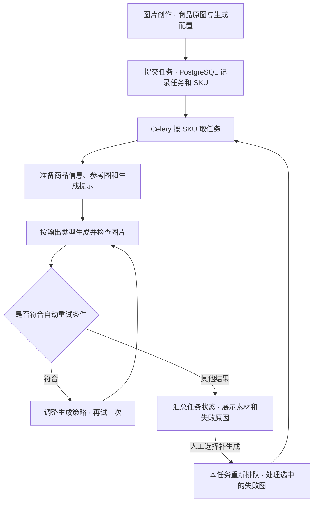

# MediaForge 业务流程与排查

启动和服务配置见 [README](../README.md#快速开始)，改动和验收约定见 [开发指南](../CONTRIBUTING.md)。

## 功能索引

| 功能 | 操作入口与行为 | 代码与验收入口 |
| --- | --- | --- |
| 表格导入 | 「爆款商品库 → 导入商品」上传 CSV 或 Excel，匹配商品图片后导入，保存商品信息、图片和检索索引。 | [导入与检索 API](../mediaforge/gateway/routers/rag.py) · [导入测试](../tests/test_product_import.py) |
| 商品链接导入与多图浏览 | 在商品库粘贴拼多多、抖音商城或 17 网分享内容。预览可切换已读取的图片，导入时首图作为封面，其余图片保留在商品相册。读取失败时可重新读取，符合条件时可手动上传。 | [链接导入](../frontend/src/components/ProductLinkImport.tsx) · [商品相册](../frontend/src/components/ProductPhotoGallery.tsx) · [本机浏览器助手](../frontend/product-browser/) · [多图导入测试](../tests/test_product_import.py) |
| 商品可见性管理 | 在商品库隐藏本企业的公共参考条目，可在「已隐藏」恢复。企业私有商品提供删除操作。 | [商品 API](../mediaforge/gateway/routers/products.py) · [隐藏、恢复和删除测试](../tests/test_product_delete.py) |
| 亚马逊调研 | 从工作台或侧栏打开「亚马逊调研」。单品、类目沿用单页查询。品牌店铺提交一次美国站店铺或栏目链接即可识别首页并逐页采集，查看来源、状态、去重 ASIN、已确认款式与配色组，展开同配色尺码。可下载采集记录，从「历史记录」恢复或重试失败项。 | [调研页面](<../frontend/src/app/(app)/research/page.tsx>) · [任务 API](../mediaforge/gateway/routers/amazon_research.py) · [店铺编排](../mediaforge/orchestrator/amazon_research.py) · [栏目采集](../mediaforge/rag/amazon_store_collection.py) · [采集与恢复测试](../tests/test_amazon_store_depth.py)。按[调研流程](#亚马逊调研)复核 REQ-001。 |
| 图片创作与拼多多默认值 | 打开空白图片创作表单，默认选中拼多多，仍可按商品切换目标平台。复用任务带入原有参数。亚马逊调研入口预选 Amazon、主图和详情图，并带入可编辑的风格要求。通过 `POST /api/v1/batch/submit` 提交异步任务。 | [创作表单](<../frontend/src/app/(app)/batch/page.tsx>) · [批量提交 API](../mediaforge/gateway/routers/batch.py)。复核空白表单、复用任务和调研带入路径。 |
| 工作台与任务详情 | 在工作台查看需要处理的任务，可隐藏单条提醒。通过「全部任务」进入详情，核对 SKU、进度、素材及失败原因。 | [工作台](<../frontend/src/app/(app)/dashboard/page.tsx>) · [任务详情](<../frontend/src/app/(app)/tasks/page.tsx>) · [任务 API](../mediaforge/gateway/routers/tasks.py) · [任务测试](../tests/test_tasks_list.py)。隐藏一条提醒并刷新，核对提醒数量及任务列表。 |
| 单图补生成 | 在任务详情的「失败原因」对单张或全部可补生成的失败图操作，可填写修改要求。复核结果回到原任务，已成功的图片仍能打开。 | [失败处理组件](../frontend/src/components/TaskFailureSummary.tsx) · [补生成测试](../tests/test_tasks_list.py) |
| 图片生成服务切换 | 在「设置 → 图片生成服务」为每套配置保存名称、API 地址、API Key 和模型。可尝试读取模型列表、手动填写模型 ID，在多套配置与系统配置间切换。复核刷新后的启用项与正确的模型路由。 | [图片服务设置](../frontend/src/components/ImageProviderSettings.tsx) · [图片服务 API](../mediaforge/gateway/routers/image_provider.py) · [图片服务测试](../tests/test_image_provider.py) |
| 智能助手 | 对话检索参考图，按确认卡片核对生成配置，确认后提交任务并跟踪进度。 | [助手 API](../mediaforge/gateway/routers/agent.py) · [助手工具](../mediaforge/orchestrator/agent_tools.py) · [任务确认测试](../tests/test_agent_production_controls.py) |

## 亚马逊调研

调研表单关闭浏览器自动填充历史。验收时聚焦链接或联想词输入框，检查浏览器历史下拉框不遮挡页面，并粘贴链接按回车提交。

1. **单品调研。** 填写 Amazon 美国站商品链接或 10 位 ASIN。报告展示公开页面可读的主图、商品价、评分、评分数、畅销排名和卖点。可补充每行一条的评论片段。报告分别标注商品公开页和手动录入来源，按评论片段提及次数整理主题，并据此给出产品复核及拍图建议。
2. **类目榜单。** 粘贴美国站 Best Sellers 链接，例如 `https://www.amazon.com/gp/bestsellers/fashion`。单次最多展示 30 件可读取商品的主图以及页面公开的排名、价格和评分。点击商品旁的「调研」打开单品报告。
3. **品牌店铺。** 粘贴带有 `/stores/` 和 `/page/` 的 Amazon 美国站店铺或栏目地址，只提交一次。也可从单品报告打开品牌店铺。采集从提交页查找品牌首页和导航，继续读取公开可发现的栏目和下拉子栏目。栏目按 UUID 去重，最多 30 个，商品卡片每栏最多 30 个 ASIN。查看「店铺栏目采集」里的原链接、最终链接、采集时间、方式、样本数量及原因。空页指公开导航或内容可以读取，页面没有可取样商品。动态占位、无法识别的结构或达到上限会显示样本不完整。Amazon 拒绝访问、拦截、超时或确定属于其他店铺时记录失败。
4. 各模式都可填搜索联想词种子并下载 Markdown。店铺还可在「店铺栏目采集」下载同一任务的 JSON，按栏目保留原样本、主图、公开报价及原币种、评分和评分数。Amazon 美国站请求设置 USD 和英语显示偏好，取样仍以页面返回的币种为准。样本汇总按 ASIN，商品可回查所在栏目。联想读取失败时，已有栏目结果仍可查看和下载。
5. 在单品报告编辑「图片制作需求」，再点「带入图片创作」。需求在当前浏览器标签页传入创作表单的风格要求。平台预选 Amazon 美国站，输出预选主图和详情图，使用已有[平台图规则](../mediaforge/workers/platform_rules.py)。填写自有商品原图、SKU、名称和类目后，按图片创作流程提交。
6. 点击「历史记录」。品牌店铺进度和样本保存在当前企业及账号下，可跨设备恢复。参数相同的在途请求共享任务，完成后用户可主动重新采集。同一提交标识用于安全重复请求。单品、类目和此前保存的店铺快照仍可在原浏览器打开。

`POST /api/v1/research/amazon` 保留原单页协议与会话或 API Key 权限。新店铺任务通过 `POST /api/v1/research/amazon/runs` 返回 202 和任务 ID。页面轮询 `GET /amazon/runs/{id}`。Celery 的 `low` 队列读取 Amazon 公开 HTML，逐页写入 PostgreSQL。每项有请求时限，最多跟随 3 次已校验的跳转、并发 3 项，网络故障或超时最多读取两次。拒绝访问或限流保留状态与原因。举例，`POST /api/v1/research/amazon/runs/{id}/retry?target=failed&item_key=section-…` 可重试指定项，有效样本保留。队列派发失败或工作进程租约过期后，可从页面恢复原任务。日志记录任务 ID、序号、状态、类型和耗时，省略请求与响应正文。

店铺翻译复用已配置的文本模型（`OPENROUTER_API_KEY`、`OPENROUTER_BASE_URL`、`AGENT_MODEL`）。通用栏目使用词表，每次任务对其余字段最多翻译两批，每批 35 个。缺译时页面继续显示原名称、ASIN、主图和链接。旧同步接口的翻译与返回格式保持原有行为。

新版本启用店铺任务前，先执行 `uv run alembic upgrade head`，再更新 Gateway、监听 `low` 队列的 Celery worker 和前端。用 `/ready` 核对 PostgreSQL、Redis，提交一次品牌店铺，检查任务能从排队到完成或部分完成。需要回退时可切回原应用版本并保留新增的快照表，确认导出或另行备份之后再决定是否回退迁移。

**商品归档（REQ-002）。** 同一 ASIN 在汇总中只计一次，同时保留每个来源栏目。款式和配色归并只使用 Amazon 卡片规格表，每份表最多保留 100 个关系 ASIN 用于关联。卡片明确标记无变体时计为独立款。只有实际出现在栏目样本里的商品参与计数，证据不足或同一 ASIN 的规格值冲突时显示「待确认」。同配色尺码折叠还需尺码以外的规格保持一致，所有已采 ASIN 均可展开并链接到来源。页面、Markdown 和采集记录同时提供去重 ASIN、已确认款式与配色组的计数以及关系缺项数量。旧任务从原快照补算，原采集时间保持原值。归档规则见 [店铺样本归并](../mediaforge/rag/amazon_store_analysis.py)。

从 Oakgarden 提交高领上衣栏目后，在「商品归档」展开一组尺码。抽查一个跨栏目 ASIN，核对它在汇总只有一个条目且带多个来源。下载报告，确认三个计数、待确认项及来源链接与页面一致。固定测试还覆盖规格表部分重叠、证据冲突与已存任务兼容。

单品接口示例传入 `{"mode":"product","source":"B0033SHO4Q","keyword":"toy story"}`。成功响应包含 `source_url`、`collected_at`、`product`、`suggestions` 和 `warnings`。链接类型不匹配时返回 `422`，上游页面无法读取时返回 `502`。

单页回归可用 `B0033SHO4Q` 和服装 Best Sellers 榜单，核对排名、主图和单品跳转。补充一条评论片段并查看来源与主题，然后编辑图片需求，检查带入「图片创作」表单。历史回归时，在原浏览器恢复改动前保存的报告，核对主图、联想词、采集时间和下载。

REQ-001 复核可从 [Oakgarden 高领上衣栏目](https://www.amazon.com/stores/page/6AFD3679-6AE1-44C6-93BD-943F86AE2B80) 提交一次，核对自动识别首页、畅销栏目及下拉子栏目。分别查看成功与空页，展开同配色尺码和 ASIN 来源，下载采集记录。再用 [LEGO 店铺栏目](https://www.amazon.com/stores/page/91C58ED9-8C8E-4B46-971F-249F016B6925) 核对不同品类、实际样本及上限提示。刷新后从「历史记录」恢复店铺。固定测试覆盖拒绝访问、部分失败、重试成功、活跃请求去重及企业与账号隔离，执行 `uv run pytest -q tests/test_amazon_research.py tests/test_amazon_store_depth.py`。

## 图片生成与失败处理



1. [任务分发](../mediaforge/orchestrator/dispatcher.py)建立任务和 SKU 记录，将工作交给 [Celery 任务](../mediaforge/orchestrator/tasks.py)。页面通过任务 API 和 SSE 获取状态。
2. [生成编排](../mediaforge/orchestrator/batch_graph.py)和[生成节点](../mediaforge/orchestrator/nodes.py)按 SKU 执行。商品原图提供款式、颜色和结构依据，参考图用于提取视觉风格。按所选输出类型生成主图、详情组图、白底图等素材。
3. [图片 Worker](../mediaforge/workers/image/base.py)执行质检和导出检查，保存实际生成的图片及其结果。生成链路在满足条件的质检失败时自动再试一次。任务可显示已完成、部分失败或失败，有图的失败结果可用于复核。
4. 任务详情的「失败原因」支持补生成单张或全部可补生成的失败图，可填写修改要求。`POST /api/v1/tasks/{job_id}/repair-images` 将指定输出放回原任务，已成功的图保持可用。任务级「重试」调用 `/retry`，按可重试 SKU 创建关联的新任务。 [失败原因组件](../frontend/src/components/TaskFailureSummary.tsx) · [任务接口](../mediaforge/gateway/routers/tasks.py)

工作台的「需要处理」区域中，点击任务旁的「隐藏」会收起这条提醒并更新数量，全部隐藏后会收起整个区域。隐藏按任务 ID 记录在当前浏览器中，刷新后仍有效。任务还可从工作台的「全部任务」查看和处理。

## 模型与规则来源

| 要查什么 | 入口 |
| --- | --- |
| 实际使用的图片服务和模型 | 「设置 → 图片生成服务」查看当前配置。Worker 执行时读取当前启用配置，提交的模型别名匹配时使用其地址、模型 ID 和密钥。系统配置见 [.env.example](../.env.example)，选择逻辑见 [nodes.py](../mediaforge/orchestrator/nodes.py)。 |
| 平台提示、输出比例和各类型验图说明 | [platform_rules.py](../mediaforge/workers/platform_rules.py) |
| 图片组内分工 | [detail_page.py](../mediaforge/workers/image/detail_page.py)定义场景图、卖点图、细节特写的生成指令。 |
| 商品一致性、输出意图、尺寸和边缘纯白等质检 | [图片 Worker 基类](../mediaforge/workers/image/base.py)。审图模型由系统 `QUALITY_MODEL` 配置，任务详情展开 SKU 可查看质检记录。 |
| 拼多多白底图导出规格 | [pinduoduo_white_background.py](../mediaforge/workers/image/pinduoduo_white_background.py)定义图像处理、输出尺寸和文件大小检查。实际商品上架以对应平台商家后台的要求为准。 |

## 失败排查顺序

先记录任务 ID、SKU、具体图片类型和当前结果。任务详情可以展开 SKU 查看本轮提示词、参考信息及质检记录。按出现异常的位置找证据。

| 现象 | 先查哪里 |
| --- | --- |
| 商品链接导入后只看到首图 | 对照导入预览和商品相册，检查本机助手识别出的图片列表、用户选择和导入后展示。 [链接导入组件](../frontend/src/components/ProductLinkImport.tsx) · [商品相册](../frontend/src/components/ProductPhotoGallery.tsx) |
| 提交失败或任务长时间排队 | 检查 API 响应、Celery Worker 日志、对应优先级队列，以及任务和 SKU 状态。 [任务分发](../mediaforge/orchestrator/dispatcher.py) · [状态存储](../mediaforge/db/job_store.py) |
| 模型调用报错或没有图片 | 先核对任务模型别名与启用的服务，结合 Worker 日志检查上游接口响应。 [模型客户端](../mediaforge/workers/openrouter_client.py) |
| 图片生成了，卖点图和细节特写未通过 | 先对照失败图和「输出意图实现度」。卖点图检查商品卖点是否在构图中突出，特写检查画面是否清楚展示局部结构或面料。复核对应输出的提示词和质检原因，再决定是否补生成。 |
| 白底图未通过 | 先看原因属于生成图片边缘检查 `deterministic_checks`，还是最终文件规格 `export_checks`。边缘近白像素不足时，先复核生成图边缘是否有灰底或阴影。 |
| 任务报告成功但图片无法打开 | 核对素材状态和文件路径，检查登录后的文件接口以及 MinIO 对象。 [文件接口](../mediaforge/gateway/main.py) · [对象存储](../mediaforge/storage.py) |

本地启动后可用以下命令检查服务并查看近期日志。API 就绪、队列响应和业务图片验收各有独立证据。

```bash
docker compose ps
docker compose logs --tail 100 api celery-worker frontend
docker compose exec -T celery-worker celery -A mediaforge.celery_app inspect ping --timeout=5
```

如果 Compose 显示 Worker `unhealthy`，先确认容器的健康检查探测对象。后端镜像的默认健康检查访问 HTTP `/health`，Worker 进程响应可用上面的 `inspect ping` 检查。具体任务仍需核对对应队列和日志。 [后端镜像](../Dockerfile) · [Compose 配置](../docker-compose.yml)

| 存储 | 用途 |
| --- | --- |
| PostgreSQL | 租户、商品、任务与素材状态、图片服务配置 |
| MinIO | 商品原图、参考图和生成素材 |
| Redis 与独立的 Redis Broker | 缓存、SSE 事件和 Celery 队列 |
| Milvus / Zilliz Cloud | 参考商品的向量检索索引 |
